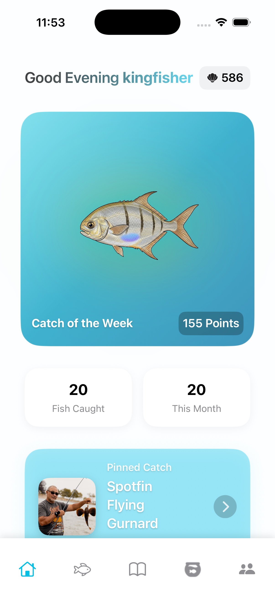
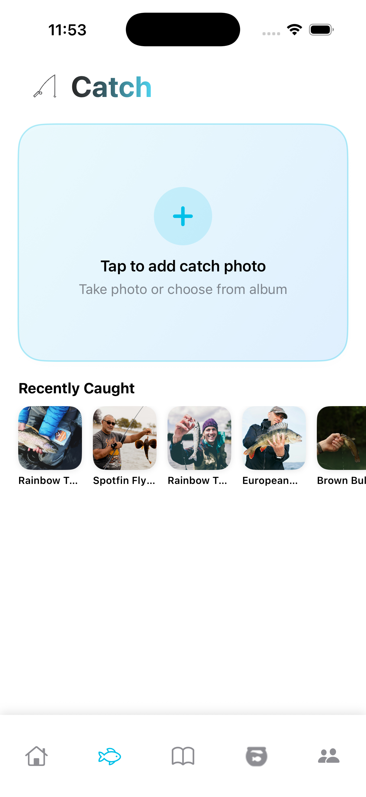
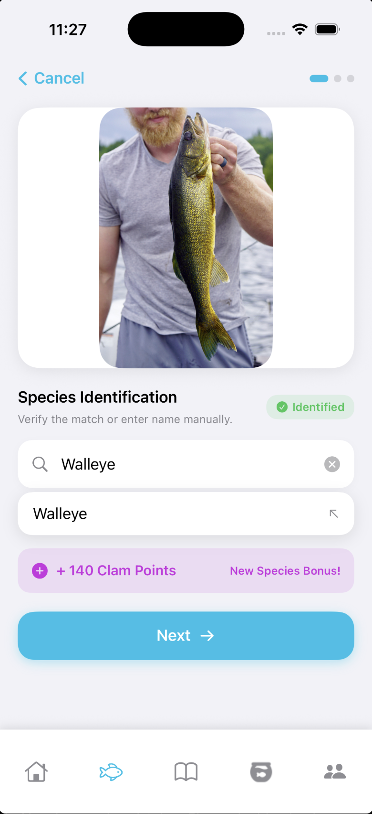
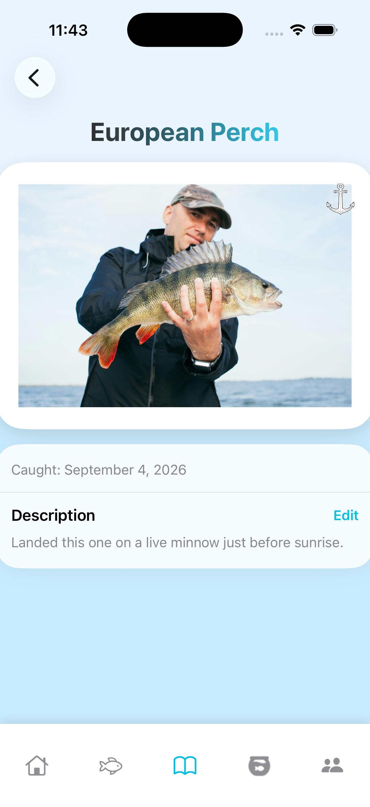
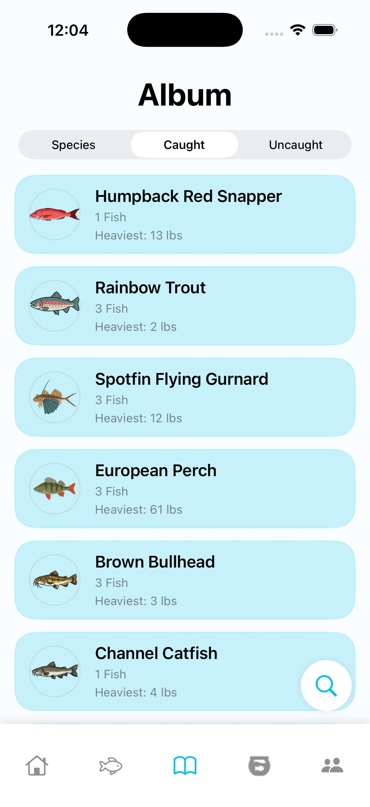
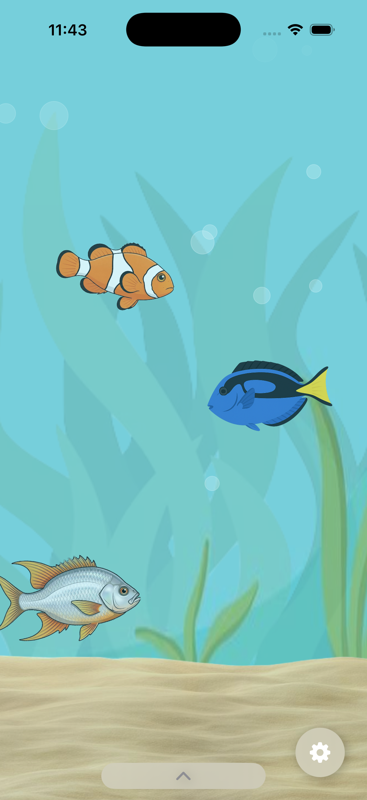
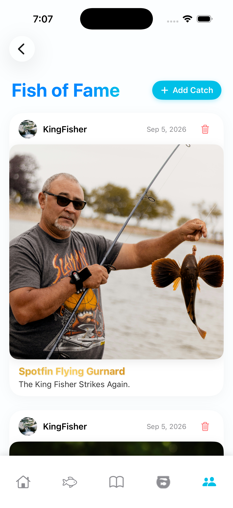
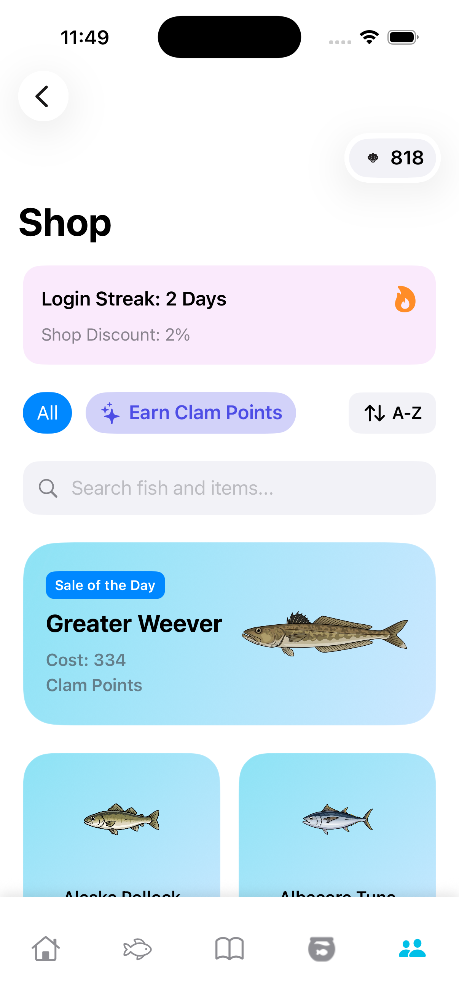

# Clamera 🎣

**Caught on Clamera** — an iOS app for logging, identifying, and showing off your fishing catches.

Clamera lets you photograph a fish, automatically identifies the species using on-device/AI vision, and tracks it in your personal aquarium collection. You can add friends, compare catches, earn Clam Points toward in-app rewards, compete for a rotating "Catch of the Week" species bonus, and share standout catches to a Fish of Fame feed.

## Features

- Camera-based catch logging with AI-assisted species identification
- Persistent aquarium collection of every fish you've caught
- Friends system with profile viewing and point gifting
- Clam Points economy with a Shop (cosmetic items, rewarded-ad point boosts)
- Weekly rotating "Catch of the Week" bonus species (deterministic, resets every Monday)
- Fish of Fame social feed
- Email/password, Google, and Sign In with Apple authentication
- Server-side username-to-email resolution (Cloud Functions) to keep user emails private

## Tech stack

- **SwiftUI** — entire client, iOS
- **Firebase** — Authentication, Firestore, Cloud Functions (Node.js/Admin SDK), used for backend logic like secure username lookup
- **Google Mobile Ads (AdMob)** — rewarded video ads for Clam Points
- **AuthenticationServices** — Sign In with Apple
- **GoogleSignIn** — Google sign-in

## Project history & my role

Clamera started as a group project with classmates in Computer Science Seminar, a course created and taught at Lower Merion High School by Mr. Thomas Swope.

Since June, 2026, I've been the sole developer: taking it from a class assignment to a published App Store app, including the entire authentication overhaul (username privacy fix, Sign In with Apple), the ad integration and AdMob setup, feature additions, numerous bug fixes, and UI/UX polish across the app.

The early commit history reflects the original group project; commits from June 20, 2026 onward are mine.

I want to sincerely thank and acknowledge everyone else who contributed to this project along the way:
- Isaac Clavijo (Student)
- Ellis Kamplain (Student)
- Kaes van Dolder (Student)
- Thomas Swope (Teacher)
- Peter Cherna (Mentor)

## Screenshots

  
  
  
  

  
  
  
  

